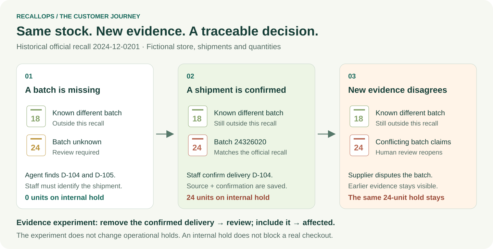
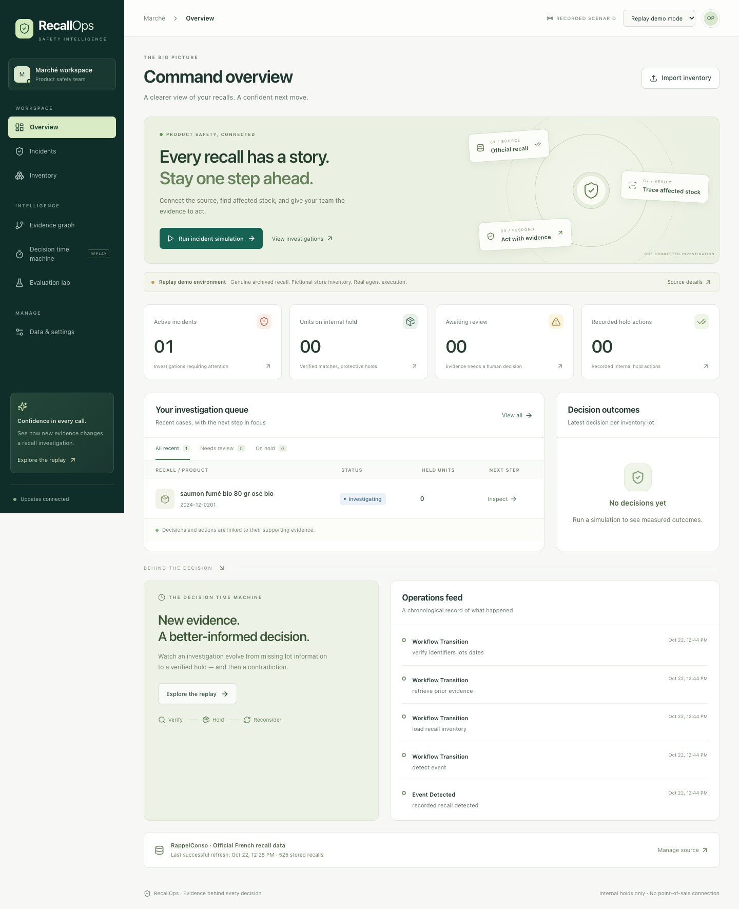
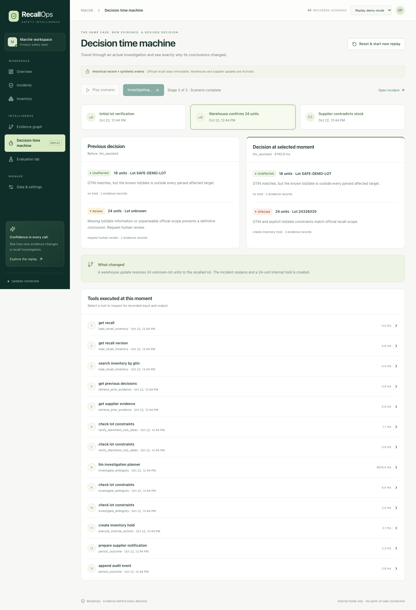
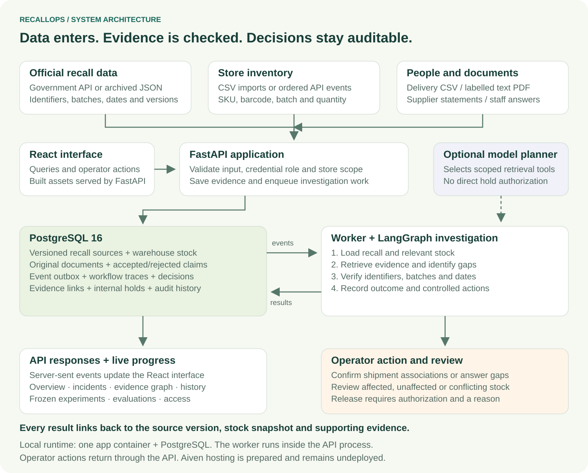
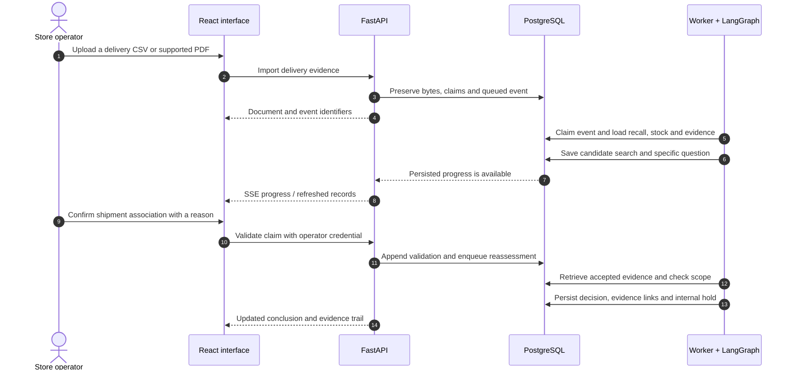
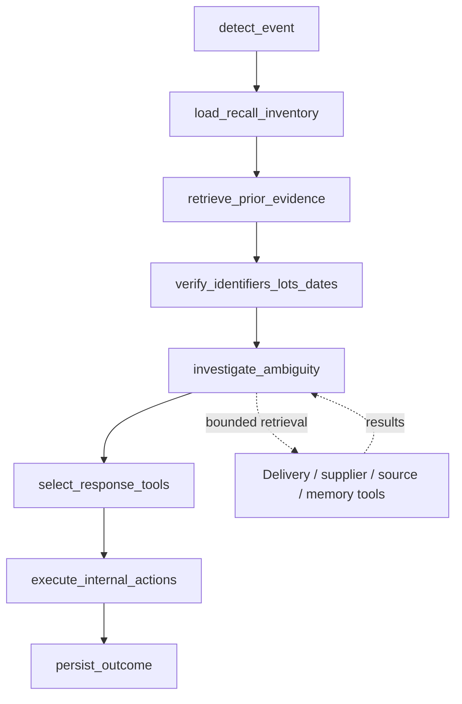
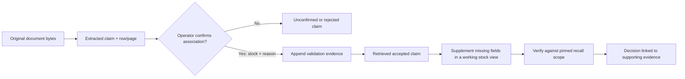
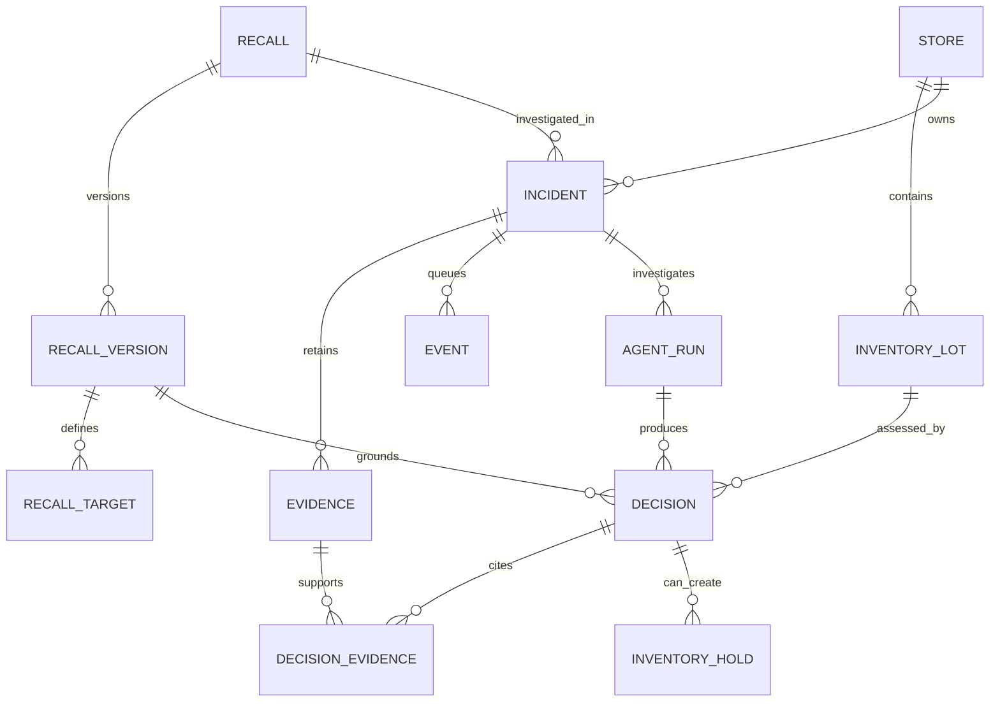

# RecallOps

### Evidence behind every recall decision

**RecallOps helps a grocery operator answer: “Does this recall affect the stock in my shop, and what evidence proves it?”**

It combines official recall notices, inventory, delivery records and human observations. An investigator searches for missing evidence, asks a specific question when necessary, and reassesses the stock as information changes. Each decision keeps its source evidence and history.

Built for **Future Founders: Data-Centric Agents**.

**Status:** working local hackathon MVP. Aiven deployment, independent customer evaluation and retailer pilots remain pending. Holds are internal application records; there is no checkout-system block or automatic supplier communication.

[Start locally](#3-run-it-locally) · [Demo](#4-follow-the-complete-demo) · [Architecture](#5-system-architecture) · [Judging criteria](#8-how-it-addresses-the-judging-criteria) · [Results](#9-measured-results-and-their-limits) · [Tests](#10-run-the-verification) · [Roadmap](#13-what-remains)



## 1. Understand the project in two minutes

A government notice recalls a particular batch of salmon. A shop has several deliveries of the same product. The barcode matches, but some batch information is missing. Staff need to determine which packets are affected, find the relevant documents, and record what they did.

RecallOps supports that investigation from the first notice to human review:

1. **Read the recall:** retain the official product identifiers, batch scope, applicable dates and source version.
2. **Find relevant stock:** compare the notice with the shop's inventory.
3. **Investigate gaps:** retrieve delivery records and other available evidence.
4. **Ask a precise question:** have an authorized operator confirm the shipment or record a checked physical batch.
5. **Reassess:** apply explicit matching rules to the supported facts.
6. **Record the outcome:** create an internal hold when stock matches; preserve uncertainty or conflicts for review.
7. **Keep the history:** show which sources supported each decision and what changed later.

### Useful vocabulary

| Term | Meaning in this application |
|---|---|
| Recall | An official notice defining affected products and scope. |
| GTIN / barcode | A product identifier. Different batches can share the same barcode. |
| Batch / lot | The production group used to distinguish affected stock from other stock. |
| Incident | A store-specific investigation associated with a recall. |
| Claim | Information extracted from a delivery record; initially unconfirmed. |
| Accepted association | A human-confirmed link between a claim and a particular stock group. |
| Internal hold | A recorded action for the operator to handle; it does not control a till or warehouse system. |
| Provenance | The source, row/page, version and validation behind a decision. |
| Retrieval memory | A hint about where useful evidence was found previously, scoped to a store and product. |

### One concrete example

The demonstration uses historical French recall **2024-12-0201**, source ID **17010**, GTIN **3760099533007**, batch **24326020**, and use-by date **2024-12-20**. The official archived record is genuine. All shop stock, quantities, deliveries and supplier statements in this scenario are fictional.

| Moment | What the system knows | Supported result |
|---|---|---|
| Initial check | 18 packets have a different known batch; 24 have no batch recorded. | The 18 are outside this recall's scope; the 24 require review. |
| Delivery search | D-104 and D-105 describe the same product and quantity, but different batches. | Ask which shipment belongs to the 24 packets. |
| Operator confirmation | The operator confirms D-104, linking those packets to batch 24326020. | The 24 match the recall; create one internal hold. |
| New contradiction | A supplier statement disputes the batch. | Record a conflict, reopen review and preserve the existing hold. |
| Separate unresolved case | Seven packets have no batch and no usable delivery evidence. | Ask for a physical batch check or source reference. |

“Outside this recall's scope” is a conclusion about that notice, not a general declaration that a product is safe.

## 2. Explore the product

| Screen | What an operator can do |
|---|---|
| **Overview** | See incident counts, held quantities, investigation queue and recent activity; start either demonstration. |
| **Incidents** | Search/filter cases and inspect decisions, investigator questions, execution traces and history. |
| **Inventory** | Download a sample CSV, validate/import stock, inspect row errors and search stock groups. |
| **Investigator** | Import delivery CSV/text PDF, confirm or reject claims, answer questions, inspect memory hints and record review resolution. |
| **Evidence graph** | Follow relationships between official sources, stock, evidence, decisions and holds. |
| **Decision time machine** | Compare the stored stages of the classic recall replay. |
| **Evaluation lab** | Run matching and investigator comparisons; import separately labelled datasets. |
| **Data & settings** | Synchronize official data, inspect refreshes and failures, check the optional model, manage stores and credentials. |

<details>
<summary><strong>Product screenshots — expand to view</strong></summary>

These are recorded local screenshots of fictional demonstrations. Screen counts and model modes describe those saved runs; they are not current deployment or performance claims. Later investigator and access-recovery controls may differ from these captures.

**Command overview**



**Decision time machine**



</details>

## 3. Run it locally

### Docker quick start

Prerequisites: Docker Desktop or Docker Engine with Compose. Initial builds need internet to download images and dependencies. The archived deterministic demo can run offline after installation.

```bash
git clone https://github.com/amithkm9/RecallOps.git
cd RecallOps

# Create configuration only when it does not already exist.
if [ ! -f .env ]; then
  cp .env.example .env
fi

docker compose up -d --build
```

Open **http://localhost:8080**. On the current development machine, `APP_PORT=8088`, so use **http://localhost:8088**.

- Health: `/api/health` — expect `status: ok` and `database: postgresql`.
- Interactive API documentation: `/docs`.
- Migrations run at startup; data persists in the PostgreSQL volume.
- The local database port defaults to `55432`; containers communicate on `5432`.
- If the app port is occupied, change `APP_PORT` in `.env` and rerun Compose.

Preserve an existing `.env`; replacing it can erase local settings and model credentials. Neither Aiven nor a model key is required for local demonstration.

### Create a demo administrator

In local development without a bootstrap token:

1. Open **Data & settings → Operations & access → Access & stores**.
2. Enter a name, choose role **admin**, and click **Create scoped credential**.
3. Copy the generated token immediately; it is shown only once.
4. Paste it into **Operator access token** and click **Save for this session**.
5. Confirm the credential-verification message before starting operator actions.

An administrator can create/reset demos, manage stores and run evaluations. A store-scoped operator can review its assigned incidents. On a protected installation, first authenticate with the configured bootstrap administrator token.

**Credential recovery:** Settings checks a proposed token before saving it. A rejected saved token is automatically cleared for read requests only when the server explicitly reports open local development access. Protected environments retain authentication requirements. A **Clear saved token** action is also available. After a frontend update, hard-refresh the browser to load the new build.

### Stop and resume

```bash
docker compose stop
docker compose up -d
```

These commands retain the database. `docker compose down -v` deletes the Compose database volume; it is not a demo reset.

## 4. Follow the complete demo

Allow **7–10 minutes**. Use **Replay demo mode** and configure administrator access before presenting. The initial investigator demo deliberately disables model calls; identify the actual execution mode shown by the app.

| Step | Click or enter | Expected observation |
|---|---|---|
| 1 | **Overview → Start investigator demo** | A fresh fictional workspace; 18 known-batch packets, 24 unknown-batch packets, and two delivery candidates. |
| 2 | Open **Investigator**, expand search results and D-104/D-105 source excerpts. | A matching barcode finds candidates but does not establish shipment identity. No initial hold. |
| 3 | On D-104, select `SALMON-DELIVERY · 24 units · Batch unknown`, enter a reason, tick the confirmation checkbox, then **Confirm association & reassess**. | Accepted evidence triggers another investigation and one 24-unit hold. |
| 4 | Reject D-105 for that stock group with a reason identifying it as another shipment. Wait for reassessment. | The alternative claim is retained as rejected evidence. |
| 5 | Under **What changed the answer?**, choose the latest completed run. Run once without optional evidence, then with **Select saved evidence**. | The 24-unit result changes from review to affected. Operational holds do not change. |
| 6 | In **Document the human resolution**, enter a finding, select supporting validation evidence and **Record review resolution**. | Review resolution is recorded; the hold remains. |
| 7 | **Evidence & execution → Add supplier evidence**: select the 24-unit group and state batch `OTHER-DELIVERY`. Add a fictional reference and explanatory notes; **Save & reassess**. | Conflict, reopened review, and the same active hold. |
| 8 | Open **Explore evidence graph** and **Activity history**. | Inspect sources, decisions and actions across the revisions. |
| 9 | Return to **Investigator → Inspect the unresolved case**. | Seven packets remain unresolved with a specific question. Leave them unanswered for the presentation. |
| 10 | **Evaluation lab → Compare investigation strategies**, with the optional model unchecked. | Measured case outcomes, tool calls, human interventions and dataset provenance. |

Example D-104 confirmation reason:

> Fictional demo: checked receiving reference D-104 against these 24 packets.

Example review finding:

> Reviewed the D-104 source and confirmed its association. The affected stock remains held for physical withdrawal.

Keep the protective hold active for the presentation. Starting another investigator demo archives the previous active replay workspace. It does not delete the saved evidence or reset live store data.

The **classic replay** is separate: **Run incident simulation → Inject next evidence → Inject next evidence** demonstrates missing batch → warehouse confirmation → supplier conflict. Its **Decision time machine** compares those stored stages.

More detail: [investigator guide](docs/investigator-guide.md), [five-minute presentation script](docs/investigator-demo.md), [classic replay script](docs/demo.md).

## 5. System architecture



### Components and responsibilities

| Component | Implementation | Responsibility |
|---|---|---|
| Operator interface | React, TypeScript, Vite, TanStack Query | Read records, submit operator actions and show progress. |
| Visual interfaces | React Flow, Recharts, Tailwind and shared controls | Evidence graph, evaluation charts and responsive screens. |
| HTTP application | FastAPI and Pydantic | Validate requests, apply access boundaries and serve the built frontend. |
| Persistence | PostgreSQL 16, SQLAlchemy, Alembic | Store sources, stock, evidence, events, decisions and audit history. |
| Workflow | LangGraph | Execute the investigation steps and retain state/tool traces. |
| Investigator | Bounded retrieval loop with optional model planning | Select available evidence searches, identify gaps and stop with a supported result or question. |
| Verification | Explicit barcode, batch and date checks | Determine affected, unaffected, review or conflict outcomes. |
| Background work | PostgreSQL outbox plus embedded worker | Process events, suppress duplicate work and retry failures. |
| Documents | CSV parsing and isolated pypdf text extraction | Preserve original bytes and extract supported fields with row/page locators. |
| Updates | Server-Sent Events (SSE) | Notify the interface when persisted activity changes. |

The local deployment has **one application container and one PostgreSQL container**. The worker is embedded in the API process. There is no separate Kafka broker, Redis service or vector database in this implementation.

### Sequence: from a delivery to a decision



### LangGraph workflow

The node names below match [workflow.py](backend/app/agents/workflow.py).



Node state, tool inputs/outputs and audit events are persisted. The graph performs deterministic verification and enters the bounded investigator before selecting permitted actions. An optional model can select read-only retrieval actions. Model wording does not become a warehouse fact, matching result or hold authorization.

See [architecture details](docs/architecture.md) and [API contract](docs/api.md).

## 6. How the data makes the agent useful

### Evidence lifecycle



Acceptance requires the selected stock group to agree with the claim's SKU, barcode and full quantity. A delivery covering only part of a stock group cannot establish the batch of the entire group. Original warehouse rows remain unchanged by claim acceptance. Contradictions remain explicit.

| Data concern | Implemented behavior |
|---|---|
| Freshness | Retain source versions, refresh attempts, last successful synchronization and visible fallback status. |
| Duplicate input | Content hashes and event/stock identities prevent repeated imports from becoming duplicate evidence or actions. |
| Provenance | Preserve original document bytes, SHA-256, source references, row/page excerpts and validation attribution. |
| Changing evidence | Append new evidence and re-investigate; retain earlier decisions and their supporting versions. |
| Conflicts | Surface disagreement and preserve existing holds pending human action. |
| Retrieval memory | Remember confirmed search routes for a store/SKU; exclude stale/rejected hints. Never transfer an old safety conclusion to new stock. |
| Missing information | Return review with a targeted question or an explicit stopping reason. |
| Evidence experiment | Recompute from a completed run's frozen recall, stock and accepted-evidence snapshot without changing operational state. |

### Important stored relationships



This is a simplified relationship map, not the complete database schema. Delivery claims, validations, operator answers and retrieval hints are evidence kinds. Original sources, evidence, decisions and audit rows have database-enforced append-only protections. Each decision must have evidence links. See [models](backend/app/models/__init__.py) and [migrations](backend/alembic/versions/).

## 7. Advanced behavior and boundaries

### Decision and action rules

| Evidence state | Decision | Operational behavior |
|---|---|---|
| Barcode, batch and applicable dates match | Affected | Create an internal hold idempotently. |
| Complete supported scope excludes this stock | Unaffected | No new hold. Existing holds still need explicit review/release. |
| Required batch/date is missing or scope cannot be interpreted | Review | Ask for evidence or human review. |
| Warehouse, accepted claims or supplier evidence disagree | Conflict | Request review and preserve any active hold. |
| Human records a resolution | Review disposition recorded | No automatic release and no declaration of safety. |
| Authorized human explicitly releases a hold with a reason | Release recorded | Append audit history; earlier evidence and decisions remain. |

### Agent limits and model behavior

The investigator chooses only available, scoped retrieval actions. It bounds tool calls, elapsed work and context, avoids repeated action keys, and records its stopping reason. Possible outcomes include supported completion, exhausted sources, a limit reached or human confirmation required.

Without a model key, deterministic planning is labelled explicitly. Provider failures can also fall back to deterministic behavior. A connection check establishes connectivity only. Operational summaries and supplier drafts use persisted facts; model suggestions remain unverified trace content.

### Recovery and concurrency

- Events have unique idempotency keys, persisted status, retry timing and attempt counts.
- PostgreSQL row claiming and advisory locks coordinate work and serialize incident/store mutations.
- Failed attempts back off; three failures mark an event failed. Operators can inspect and retry failed work with a reason.
- If a decision was committed before a failure, recovery finishes its saved outcome instead of recomputing it against newer evidence.
- State is saved between nodes; native LangGraph checkpoint-level resume is not implemented.
- Ordered inventory intake rejects old sequence numbers and conflicting duplicates.
- Run one API process with its embedded worker for the MVP. Scaling replicas and sustained production capacity require additional verification.

### Access and review

| Role | Scope |
|---|---|
| `admin` | Administration, source synchronization, credentials, demos and evaluation. |
| `operator` | Assigned-store investigations, evidence and authorized human review. |
| `integration` | Assigned-store inventory/supplier event submission; no hold release or administration. |
| `viewer` | Assigned-store read access; mutations rejected. |

Named tokens are shown once and stored as hashes. The UI keeps its token in browser session storage; model keys stay server-side. This is scoped credential access, not an enterprise SSO or user-account system.

Review resolution is guarded against stale runs, changed live recall versions and unsettled work. Closing a case additionally requires supporting evidence, no active holds and no affected/uncertain conclusions. New evidence can reopen review.

### Documents and source coverage

Delivery PDF support covers labelled, selectable text with an unambiguous record per page. Scans, repeated ambiguous batch fields and unsupported layouts remain unresolved. Extraction is bounded to 20 pages and runs in a limited child process. OCR and arbitrary document understanding are not implemented.

Official attachments are retrieved only from recognized fields and allowlisted HTTPS hosts. Downloaded text remains evidence for review; it does not independently establish a matching scope or exclusion.

Official synchronization is bounded by `SOURCE_MAX_RECORDS`. A failed live request can load the archived fixture with explicit fallback disclosure. It does not advance the successful-live-sync timestamp. Neither a bounded scan nor missing source records proves that all recalls were checked or withdrawn. Source details and reuse attribution are in [data-source.md](docs/data-source.md).

## 8. How it addresses the judging criteria

The following maps the supplied competition brief to implemented behavior, a demonstration moment and the evidence still needed. It is not a predicted judging score.

| Criterion | What RecallOps demonstrates | Show the judges | Remaining evidence or work |
|---|---|---|---|
| **Customer Problem & Product Value** | Helps grocery operators investigate batch-specific recalls when stock records are incomplete. | The 24 packets with a missing batch, and the precise shipment-confirmation question. | Interviews, independently reviewed retailer cases, measured effort and willingness to adopt/pay. |
| **Agent Capability** | Multi-step retrieval, explicit uncertainty, scoped tools, targeted questions and reassessment after new evidence. | Actual execution trace from delivery search through confirmation to a revised decision. | Broader model evaluation; the deterministic benchmark does not prove model superiority. |
| **Data at the Core** | Versioned sources, original documents, validated associations, freshness, conflicts and durable evidence links drive decisions. | The same frozen stock/recall yields review without delivery evidence and affected with it. | More authentic delivery formats and real retailer integrations. |
| **Evidence It Works** | Reproducible comparisons, fault/recovery tests, an isolated first-install test and persisted results. | Evaluation Lab, individual expected/predicted outcomes and the recorded fresh-run report. | Independent labels and customer measurements; synthetic correctness is not population-level accuracy. |
| **Execution & Pitch** | Working local product, guided demonstration, visual evidence graph, editable pitch and proposed pilot route. | A complete investigation journey plus the pitch slide. | Hosted acceptance checks and actual pilot recruitment. |

### Relationship to the suggested challenge directions

| Direction in the brief | Fit |
|---|---|
| Analyst agent | Specialized stock/recall analysis with cited evidence. It is not a general natural-language SQL analyst. |
| Event-driven agent | New recall, inventory and evidence events trigger recorded investigations through the outbox. |
| Agent with memory | Store-scoped retrieval hints are implemented; measured improvement is not established. |
| Data-to-answer detective | Frozen evidence experiments show which evidence changes a result; traces expose the supporting source chain. |
| Self-improving agent | Comparative evaluation exists. An autonomous optimizer that proposes and validates its own improvements is not implemented. |

### Aiven requirement and sponsor prize

The brief asks teams to deploy to **Aiven Runtime** and use managed data services where relevant. This repository prepares an application container and a managed PostgreSQL connection path. **No Aiven deployment has been performed.** Local PostgreSQL use alone does not establish Aiven-platform usage or satisfy hosted acceptance.

See [deployment handoff](docs/deployment.md), [application manifest](compose.aiven.yaml) and [static deployment checker](scripts/deployment_check.py).

### Pitch and route to first users

> RecallOps helps grocery operators investigate product recalls against their stock. It retrieves delivery evidence when batch information is missing, asks staff to confirm shipment associations, and preserves an inspectable record of every decision and hold.

The proposed first pilot is with **three to five grocery operators** who can supply authorized, de-identified historical stock and delivery records. Compare their existing investigation process with RecallOps on the same evidence; record correctness, active staff time, intervention count and unresolved cases before discussing pricing. No outreach, adoption or revenue is claimed.

Artifacts: [editable one-slide pitch](docs/recallops-pitch.pptx), [pitch preview](docs/recallops-pitch.png), [pilot proposal](docs/pilot-plan.md).

## 9. Measured results and their limits

### Investigator comparison

The [recorded fresh run](docs/fresh-e2e-results.json) used **12 developer-authored synthetic cases**, with model calls disabled.

| Method | Exact expected verdicts | Total tool calls | Operator interventions | Fixture setup confirmations |
|---|---:|---:|---:|---:|
| Existing workflow | 6 / 12 | 134 | 9 | 7 |
| Fixed retrieval | 12 / 12 | 202 | 7 | 7 |
| Adaptive investigator with memory | 12 / 12 | 152 | 7 | 7 |
| Adaptive investigator without memory | 12 / 12 | 132 | 7 | 7 |

An exact expected verdict can be **review** or **conflict**. Therefore 12/12 does not mean every case was resolved without a person. The seven setup confirmations are human evidence supplied by the fixtures, separate from later operator interventions.

On this suite, additional retrieval improved expected-verdict agreement. Memory increased tool use without improving correctness. These results do not establish independent accuracy, staff time saved, cost savings or model superiority.

The original matching benchmark is a separate **22-case** suite. External-label import records the declared source/labeler/split and dataset hash; a `held_out` declaration is not independently verified merely because it is uploaded.

### Verification record

| Check | Recorded result | Evidence / scope |
|---|---|---|
| Empty-install HTTP verification | **59 verification checks passed**, including suite executions | [Fresh report](docs/fresh-e2e-results.json): own database/network/containers, new credentials and business records, restart and restore checks. |
| Backend regression suite | **120 passed** | Included in the fresh report; isolated test database, including real PDF extraction and crash/retry behavior. |
| Frontend suite at the fresh-run snapshot | **12 passed** | Historical count in that report, before the credential-recovery extension. |
| Subsequent credential-recovery verification | **24 passed: 22 offline tests + 2 local HTTP checks** | [API regression tests](frontend/src/api.test.ts) and component suites; includes the previously rejected-token path. No browser control. |
| Investigator browser journeys | **4 passed in the earlier investigator verification** | [Recorded status](docs/investigator-status.md) and [browser tests](frontend/e2e/investigator.spec.ts); not rerun by the HTTP-only fresh test. |
| Real model functional path | Successful recorded provider call selecting delivery search | [Provider verification](docs/investigator-verification.json); tests that path, not general model quality. |

The latest credential-recovery build was rebuilt and checked at the local app endpoint. Historical reports retain their original counts and observations; do not combine them into a single independent benchmark.

## 10. Run the verification

### Full first-install test without browser automation

Prerequisites: Docker Compose, Python 3, Node/npm and installed frontend test dependencies.

```bash
npm --prefix frontend ci
python3 scripts/fresh_e2e.py
```

The runner builds the app, creates its own empty PostgreSQL container/network/volume, verifies the zero-record state, and creates credentials, stores, inventory and evidence through HTTP. It exercises investigations, reviews, evaluations, access restrictions, production authentication, restart persistence and a restore into a separate database. Backend regression tests use another test database.

It does not load the project `.env`, use the existing application database or call external model/recall APIs. Isolated containers stop afterward; the test volume is retained. Results are written to `docs/fresh-e2e-results.json`; use `--output /path/to/report.json` to preserve the checked-in report. Browser rendering and Aiven hosting are outside this test.

### Focused checks

```bash
# Backend suite in the separate Compose test database.
make test-docker

# Frontend unit/component tests. Optional HTTP cases are skipped here.
npm --prefix frontend test -- --run

# Include the two read-only recovery checks against an open local dev app.
VITE_RECALLOPS_TEST_URL=http://127.0.0.1:8088 npm --prefix frontend test -- --run

# Type checking and production assets.
npm --prefix frontend run build

# Repository deployment wiring only; provisions nothing.
python3 scripts/deployment_check.py
```

The broader `make e2e` command also adds replay/evaluation records to its configured local application database. Run it only in a development/test environment. Optional browser checks and provider-backed verification have their own requirements; see [operations](docs/operations.md) and [feature verification](docs/feature-validation.md).

## 11. Developer setup and operations

### Source development

Use Python **3.12+**, Node **22+**, and PostgreSQL. Docker is the simplest way to supply the database.

```bash
docker compose up -d db
python3.12 -m venv backend/.venv
backend/.venv/bin/python -m pip install -r backend/requirements.txt
npm --prefix frontend ci
make migrate
make dev
```

In another terminal:

```bash
npm --prefix frontend run dev
```

Vite proxies `/api` to the host backend on port `8080`. Stop the Compose app before running a host backend on the same port. Ensure the host `DATABASE_URL` matches the database port/password; the container database URL is configured separately by Compose.

### Configuration

See [.env.example](.env.example) for the full template. Keep populated secrets outside Git.

| Variable | Purpose |
|---|---|
| `DATABASE_URL` | PostgreSQL connection URL; `postgres://` and `postgresql://` forms are accepted. |
| `POSTGRES_PASSWORD`, `POSTGRES_PORT` | Local Compose database password and published port. |
| `ENVIRONMENT` | Local `development` or protected `production` behavior. |
| `OPERATOR_TOKEN` | Bootstrap administrator token; configure a strong runtime secret for protected hosting. |
| `DEMO_ENABLED` | Enable historical replay routes. |
| `PUBLIC_DEMO` | Explicit fictional showcase mode; use a separate database from customer records. |
| `LLM_API_KEY`, `LLM_BASE_URL`, `LLM_MODEL` | Optional server-side model provider. Key aliases include `OPENAI_API_KEY`; Compose also supports `openai_api_key`. |
| `SOURCE_REFRESH_SECONDS` | Scheduled synchronization interval; `0` means manual-only. |
| `SOURCE_MAX_RECORDS` | Bounded per-query source scan limit; default `1000`. |
| `WORKER_ENABLED` | Enable the embedded background event worker. |
| `APP_PORT`, `PORT` | Local published application port and container listener. |
| `ALLOWED_ORIGINS` | Additional explicitly permitted mutation origins. |
| `MUTATION_LIMIT_PER_MINUTE` | PostgreSQL-backed request mutation budget. |

After changing `.env`, recreate the app container:

```bash
docker compose up -d --force-recreate app
```

### API orientation

Compatibility routes are under `/api`; equivalent versioned routes are under `/api/v1`. Send `Authorization: Bearer <credential>` for protected actions. Use the generated `/docs` schemas for exact request fields.

| Operation | Route |
|---|---|
| Health / dashboard | `GET /api/health`, `GET /api/dashboard?mode=replay` |
| Source synchronization | `POST /api/recalls/sync` |
| Inventory CSV / ordered events | `POST /api/inventory/import`, `POST /api/stores/{id}/inventory-events` |
| Investigator view / delivery upload | `GET /api/incidents/{id}/investigator`, `POST /api/incidents/{id}/investigator/deliveries` |
| Confirm/reject a claim | `POST /api/incidents/{id}/investigator/claims/{claim_id}/validate` |
| Checked answer / review resolution | `POST /api/incidents/{id}/investigator/answers`, `POST /api/incidents/{id}/investigator/resolve` |
| Frozen experiment | `POST /api/incidents/{id}/investigator/simulate` |
| Supplier evidence / human action | `POST /api/incidents/{id}/supplier-evidence`, `POST /api/incidents/{id}/review` |
| Investigator demo / evaluation | `POST /api/investigator/demo`, `POST /api/investigator/evaluation` |
| Worker health / progress stream | `GET /api/operations/health`, `GET /api/events/stream` |

### Backup and restore rehearsal

```bash
bash scripts/backup.sh
# Replace the path below with the actual filename printed by the backup command.
bash scripts/restore_drill.sh backups/YOUR-BACKUP-FILENAME.dump
```

The restore drill creates a separate database. Backups are private local files excluded from Git. External monitoring, offsite backup scheduling and retention policy remain deployment/customer work. See [operating instructions](docs/operations.md).

## 12. Repository map

```text
RecallOps/
├── frontend/
│   ├── src/                  React screens, controls, API client and unit tests
│   └── e2e/                  Browser journey tests
├── backend/
│   ├── app/
│   │   ├── api/              HTTP routes and request handling
│   │   ├── agents/           LangGraph, bounded investigator, tools and model adapter
│   │   ├── core/             Settings, database, authentication and guardrails
│   │   ├── models/           PostgreSQL entities and relationships
│   │   ├── repositories/     Persistence helpers and response views
│   │   ├── schemas/          Typed request, evidence and evaluation contracts
│   │   └── services/         Ingestion, inventory, evidence, events and evaluation
│   ├── alembic/              Versioned schema and provenance protections
│   └── tests/                Matching, permissions, provenance and recovery tests
├── data/fixtures/             Historical official records and synthetic test cases
├── docs/
│   ├── diagrams/             Editable SVG architecture and workflow illustrations
│   ├── screenshots/          Recorded local product screenshots
│   └── ...                   Guides, measured reports, pitch and deployment handoff
├── scripts/                  Verification, startup, ingestion and backup tools
├── Dockerfile                Frontend build plus Python application runtime
├── compose.yaml              Local app and PostgreSQL
└── compose.aiven.yaml         Prepared app-only hosting manifest
```

## 13. What remains

| Area | Current state | Next acceptance step |
|---|---|---|
| Aiven deployment | Configuration prepared; not deployed. | Configure project/runtime/managed database, deploy and verify HTTPS, TLS, access and persistence. |
| Customer validation | Customer and pilot hypothesis documented. | Recruit authorized participants and observe their actual recall workflow. |
| Independent evaluation | Import interface implemented; built-in labels are developer-authored. | Obtain separately reviewed cases and preserve a held-out evaluation set. |
| Retailer integrations | Generic CSV/API intake exists. | Connect authorized warehouse/supplier systems and validate mappings. |
| Document automation | Labelled text PDFs and CSV supported. | Evaluate real document variation; add OCR only with appropriate evidence and tests. |
| Memory / self-improvement | Retrieval hints and ablations implemented. | Show a measured benefit before claiming learning; autonomous optimization is not built. |
| Production operations | Local recovery, access controls and restore checks work. | Validate capacity, monitoring, offsite recovery, HTTPS and identity requirements in the hosted environment. |
| External actions | Holds and drafts remain internal. | Specify and validate any future POS or communication integration with customers. |

Detailed references: [implementation status](docs/investigator-status.md), [project plan](PLAN.md), [data provenance](docs/data-source.md), [pilot plan](docs/pilot-plan.md), [deployment acceptance](docs/deployment.md).
