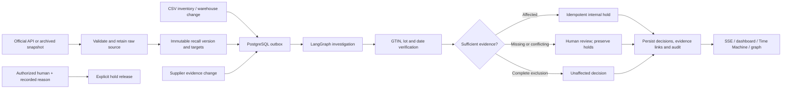

# Investigation architecture

The investigator extension adds immutable delivery-document and claim evidence. An explicit operator validation associates a claim with a stock group; SKU, GTIN, and full quantity must agree. The workflow begins with warehouse/source checks, then retrieves candidate delivery claims using bounded scoped tools. Only retrieved, currently accepted claims can supplement missing stock fields. Disagreement triggers conflict; warehouse rows remain unchanged. Every used claim references its source and validation record.

The planner selects from available read-only actions: delivery search, supplier evidence, validated retrieval hints, pinned source-document inspection, and recall-version comparison. It stops on completion, exhausted sources, a call/time limit, or human confirmation. Provider failure and excessive context use explicit fallback. Progress commits preserve tool results, while retries after decision persistence finish the original frozen outcome instead of recomputing it against changed evidence.

Experiments reuse a completed run's frozen warehouse inventory, recall version, and accepted-claim snapshots. They admit only evidence available to that run and cannot create decisions, events, or holds. Review resolution is an attributed note with a stale-run guard, distinct from release and final case closure. See the [operator guide](investigator-guide.md).

## Graph and tools

The graph detects an event, pins its recall version, loads candidate inventory, retrieves prior decisions and supplier evidence, performs deterministic checks, conditionally investigates uncertainty, chooses permitted response tools, executes internal actions, and persists the outcome. An optional model can select additional evidence-retrieval tools and draft commentary. Its output is never fed into match verification or hold authorization.

Tool calls validate incident/inventory scope. Each run stores input/output trace, timing, current node, JSON state, explanation and notification draft. Each decision references a recall version and relational evidence IDs. Database triggers prevent updates/deletes to source versions, targets, evidence, decisions and audit rows and reject decisions without evidence.

## Event processing and recovery

Events have unique idempotency keys, persisted status, attempts, retry availability and completion time. A worker claims rows with `FOR UPDATE SKIP LOCKED`; session advisory locks serialize duplicate deliveries and incident processing across commits. Failed attempts back off; three failures mark the event failed. A stale processing lease can be retried after five minutes. Completed runs and unique hold constraints prevent duplicate actions.

Graph state is persisted after each node. Recovery currently restarts the graph under the same event/run identity and reuses completed actions. It is not native LangGraph checkpoint-level resume. Deploy one API process with its embedded worker for this MVP; test concurrency and ordering further before scaling replicas.

## Safety policy

| Evidence | Decision/action |
|---|---|
| Identifier, lot and applicable dates match | Affected; internal hold |
| Known lot/date excluded by complete parsed scope | Unaffected; no new hold |
| Missing lot/date or unknown scope | Review |
| Warehouse/supplier conflict | Conflict; human review |
| Existing hold followed by uncertainty or changed scope | Preserve hold; review |
| Release request | Operator token plus reason; explicit audit |
| Supplier communication | Draft only; nothing sent |

An internal hold is an application record. It does not disable a checkout or reserve warehouse stock in an external system.

## Isolation

Stores distinguish `live`, `replay` and `evaluation`. Replay reset archives the prior fictional store. Evaluation records are labeled synthetic and excluded from official-source counts. Public-demo routes reject live business access. A dedicated public demo database is recommended. The single operator token is an MVP authorization mechanism; individual user identities and tenant RBAC are not implemented.
